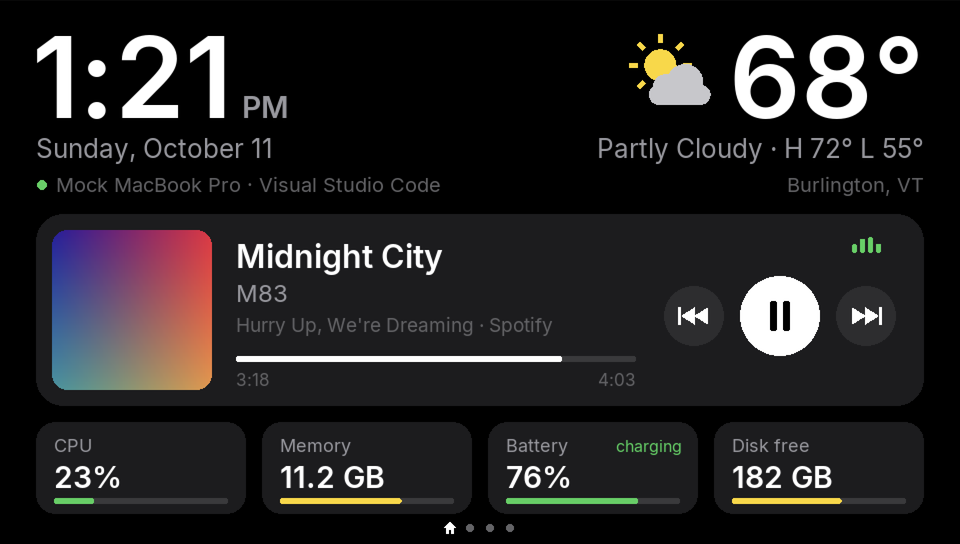
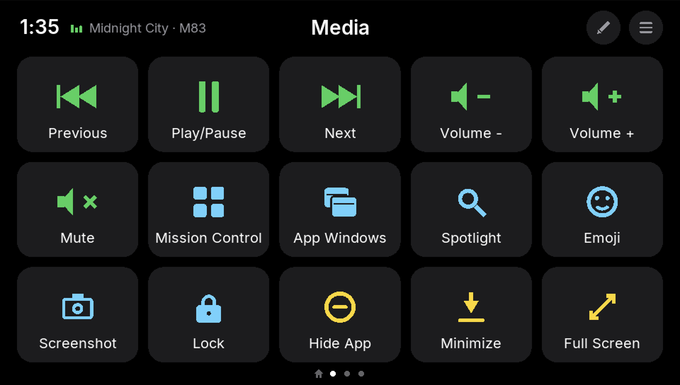
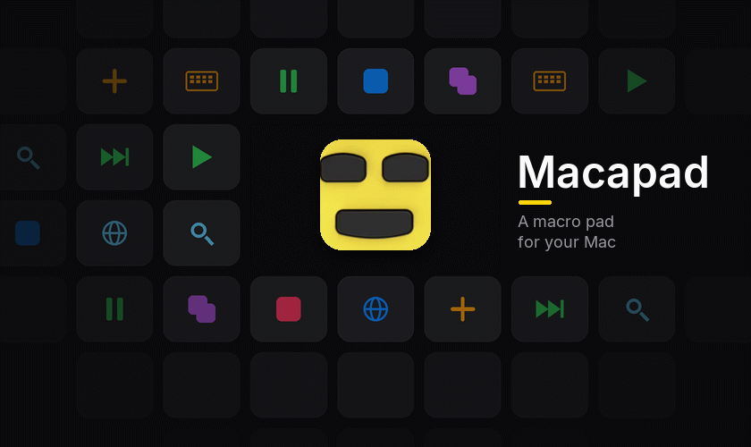

# PS Vita Macapad

A [Macapad](https://github.com/AD-Archer/Macapad) client that turns a PlayStation Vita into a macro pad for your Mac.

  
  

The first page is a dashboard: the time, the weather, what's playing (with play controls) and how the Mac is doing.

Swipe for pages of keys that run Mac actions, open apps and websites (with their icons), press shortcuts or run
Shortcuts. Make up to 12 pages of 15 keys, right on the Vita.

You'll need [Macapad](https://ad-archer.github.io/Macapad/) running on your Mac, on the same Wi-Fi as the Vita.

## Install with VitaShell

In VitaShell, hold **←** on the D-pad and press **○** to open the QR code scanner, then scan this. It always installs
the newest release.

Or grab `macapad.vpk` from the [newest release](https://github.com/AD-Archer/vita-macapad/releases/latest), copy it to
the Vita (VitaShell's FTP or USB) and install it from VitaShell. Needs a Vita running HENkaku/Ensō (a PS TV has no
camera, so use the second way there).

  

## Docs

**[Read the docs →](docs/README.md)** for pairing, buttons, building and more.

## License

Copyright (C) 2026 Antonio Archer. GPL-3.0, see [LICENSE](LICENSE). Includes [Inter](https://rsms.me/inter/) under the
SIL Open Font License ([assets/fonts/OFL.txt](assets/fonts/OFL.txt)) and [jansson](https://github.com/akheron/jansson)
under the MIT license.
